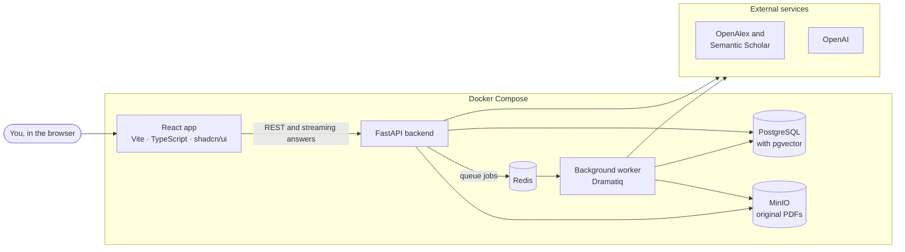
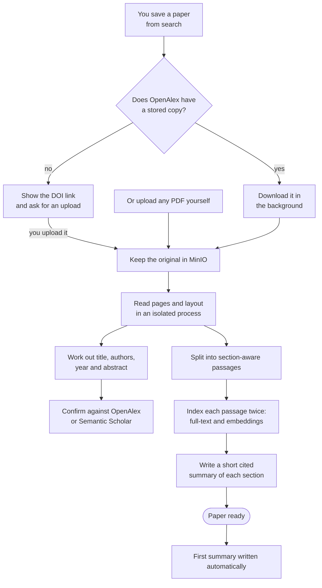
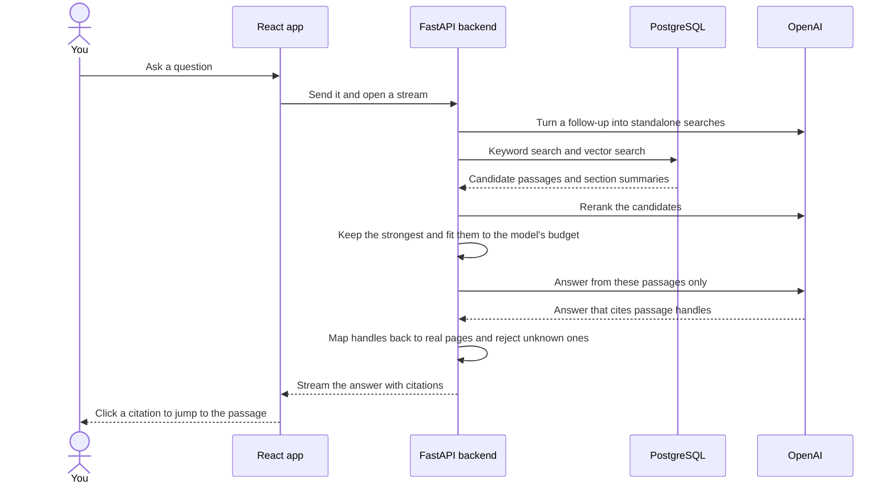

<p align="center">
  <picture>
    <source media="(prefers-color-scheme: dark)" srcset="branding/ara-wordmark-dark.svg">
    
  </picture>
</p>

<p align="center">
  <em>Find papers, keep them, read them, and ask them questions.</em>
</p>

<p align="center">
  <a href="LICENSE"></a>
  
  
  
  
  
</p>

<p align="center">
  <a href="#quick-start">Quick start</a> ·
  <a href="#supported-models">Models</a> ·
  <a href="#feature-walkthrough">Features</a> ·
  <a href="#how-it-works">How it works</a> ·
  <a href="#open-models-experimental">Open models</a> ·
  <a href="docs/reference.md">Technical reference</a>
</p>

> **Try the live demo at <https://vps-eb56b28c.vps.ovh.us>**
>
> You need to be on Purdue's on campus network to open it directly. From anywhere else, including Purdue's VPN, it asks for the demo login. Reach out to me for the credentials.

---

ara is the AI research assistant I built for Homework 1 of CS 59300 at Purdue. The name means "search" in Turkish, and it also happens to spell **A**I **R**esearch **A**ssistant.

You type a topic and ara searches OpenAlex or Semantic Scholar for you. The papers you like go into a library that survives refreshes and restarts. Once a paper has a PDF, either a copy OpenAlex has stored or one you upload yourself, ara reads it, works out the title, authors, year and abstract, and indexes the full text. From then on you can ask for a summary or ask it questions, and every answer points back to the page it came from. Click a citation and the PDF scrolls to that passage and highlights it.

I wanted it to feel like the tools I already use for research (ChatGPT, Claude, Elicit, SciSpace), so the whole app is one chat-style workspace. Under the hood it's a mixed pipeline of retrieval-augmented generation (RAG) and large language models (LLMs). In ara, LLM never reads a whole paper in one go. It gets the handful of passages that matter for your question, and it grounds its responses based on those evidences.

## How ara addresses the homework requirements

| The assignment asks for | Where it lives in ara |
| --- | --- |
| Searching for papers, with title, authors, year, abstract and link | The home screen's search box, backed by OpenAlex or Semantic Scholar |
| Saving papers to a local library that persists | One click per result. PostgreSQL keeps the library, and the Library page lets you browse it |
| Uploading PDFs and extracting their metadata | Drop a PDF anywhere. ara reads the title, authors, year and abstract from the file, then checks them against a catalog |
| LLM summaries based on the paper's content | Summaries are written from passages of the full text, with page citations |
| Questions about a paper | A streaming chat with inline page citations, for one paper or several |
| GUI, frontend and backend, external API, local database, PDF processing, LLM API | React frontend, FastAPI backend, OpenAlex and Semantic Scholar, PostgreSQL and MinIO, PyMuPDF, OpenAI |

## Quick start

The main way to run ara is with your own OpenAI, OpenAlex and Semantic Scholar API keys. It's also the setup I've tested the most.

### What you need

- Docker with Docker Compose
- Python 3, only for the one-off bootstrap script
- Three API keys:

| Key | What it unlocks | Without it |
| --- | --- | --- |
| `OPENAI_API_KEY` ([get one](https://platform.openai.com/api-keys)) | Summaries, answers, the semantic search index and reranking | Search, the library and uploads still work, but anything that needs an LLM to function says it isn't available |
| `OPENALEX_API_KEY` ([OpenAlex](https://openalex.org)) | Automatic PDF downloads from OpenAlex's stored copies. Each download costs a little of the key's daily allowance, and the free tier covers normal use | Search still works. You download PDFs from the DOI link and upload them yourself |
| `SEMANTIC_SCHOLAR_API_KEY` ([request one](https://www.semanticscholar.org/product/api)) | Dependable Semantic Scholar search and metadata lookups | Anonymous requests work but get rate limited quickly |

### Run it

```bash
git clone git@github.com:friberk/ara.git
cd ara
python3 scripts/bootstrap.py
```

The bootstrap script writes a private, git-ignored `.env` with random passwords for the internal services. Open it and fill in your keys:

```dotenv
OPENAI_API_KEY=sk-...
OPENALEX_API_KEY=...
SEMANTIC_SCHOLAR_API_KEY=...
```

Then start everything:

```bash
docker compose up --build
```

The first build takes a few minutes. Compose creates the storage bucket and runs the database migrations before the API starts, so there's nothing else to set up. When it settles, open <http://localhost:5173>. The API's interactive docs are at <http://localhost:8000/docs>.

Some practical notes:

- Your keys stay on the backend. The browser talks to ara's own API and never sees them.
- `LLM_DAILY_BUDGET_USD` in `.env` caps how much ara spends on OpenAI per day. `DEFAULT_MODEL` sets the starting default model, which you can change later in Settings panel in the app.
- `docker compose down` stops the app and keeps your library. Don't add `--volumes` unless you really want to wipe every paper, PDF and chat.
- In development, the frontend, API and worker all reload when you edit their source.

## Supported models

Every model ara can use is listed in a catalog in the backend, along with its context window, prices and reasoning levels. Nothing in the app hardcodes a model, so adding one is a new catalog entry. With an OpenAI key, these are the models you can choose from:

| Task | Models | Default |
| --- | --- | --- |
| Answers and summaries (LLM) | GPT-5.6 Sol, GPT-5.6 Terra, GPT-5.6 Luna | GPT-5.6 Luna |
| Search index (embeddings) | `text-embedding-3-large`, `text-embedding-3-small` | `text-embedding-3-large` |
| Reranking | GPT-6 Luna | On |

You pick the LLM and its reasoning effort per message in the composer, and you set the default in Settings. Sol is the most capable and the most expensive of the three, and Luna is the cheapest. The smaller jobs around a chat follow the same choice. Turning a follow-up into search queries and summarizing older turns use whatever model and effort the chat is using. Background work that isn't tied to a chat, like the first summary of a new PDF, the per-section summaries and the metadata fallback for a stubborn PDF, uses your default model.

The embedding model applies to the whole library, because vectors from different models can't be compared. Switching it in Settings asks first, then rebuilds every paper's index in the background, and questions keep using the old index until the new one is ready. Reranking can be turned off in the same place if you'd rather trade some answer quality for speed and cost.

With [open models](#open-models-experimental) turned on, these local models are added to the same menus:

| Task | Local models (via Ollama) |
| --- | --- |
| Answers and summaries (LLM) | IFM K2 Horizon 3.7B, IFM K2 Horizon 7B, Qwen 3.8 27B |
| Search index (embeddings) | Qwen3 Embedding 4B, Qwen3 Embedding 8B |
| Reranking | Qwen3 Reranker 0.6B |

## Feature walkthrough

Here's the app in roughly the order you'd use it in a real session.

### 1. Search for papers

The home screen is a single search box. Type a topic, a title or a research question, pick OpenAlex or Semantic Scholar, and you get a list of papers with their title, authors, year, abstract and DOI or PDF links. Anything already in your library is marked as such, and recent searches stay in the sidebar so you can jump back to them.

### 2. Build your library

Save a result with one click. Saved and uploaded papers live in the Library, which you can filter by title. Each row shows the state of the paper's PDF at a glance. From a row you can edit the paper's details, look them up again, or delete it. You can also select several papers and delete them together. Before anything is deleted, ara tells you exactly what goes with it: the PDF, its search index, its summaries and any chats that were only about that paper.

### 3. Get the PDF automatically

When you save a paper that OpenAlex has a stored copy of, ara fetches the PDF in the background without you clicking anything. If there's no stored copy, the paper is paywalled, or you haven't set an OpenAlex key, ara links to the DOI and asks you to upload the PDF yourself.

### 4. Upload your own PDFs

You can drop a PDF on the home screen, in the Library or inside a paper. The upload shows real progress, and then a short checklist follows the paper from reading its pages through finding its details to ready. The Library takes several PDFs at once. If an upload turns out to be a paper you already have (e.g., same DOI, same arXiv ID, a clearly matching title), ara attaches it to that paper instead of creating a duplicate, and it asks before replacing a PDF you already had.

### 5. Metadata you don't have to fix by hand

PDF metadata is often wrong. Plenty of files call themselves `paper.dvi` or `Microsoft Word - draft.docx`. ara reads the file's embedded metadata and the layout of its first page, and asks the model only when those come up short. Then it looks the paper up in OpenAlex or Semantic Scholar, by DOI or arXiv ID first and by title second, and accepts a title match only when the authors or the year agree too. Anything you edited by hand is never overwritten.

### 6. Read in the paper workspace

Opening a paper gives you the PDF reader next to the conversation. The reader starts with the paper's bibliography (authors, venue, DOI, abstract) and scrolls into the PDF itself. A small info dialog shows where each detail came from and the state of the paper's search index. The PDF menu lets you download the original, replace it or remove it. On a phone, the workspace switches between the chat and the PDF.

### 7. Get a summary

As soon as a paper's PDF is ready, ara writes a first summary with the selected default LLM, and it sits at the top of the paper's chat. The summary comes from the paper's full text, and it cites its pages like any other answer. You can regenerate it whenever you want.

### 8. Ask questions with citations

Ask anything, or start from one of the suggested questions ("What problem does this paper address?", "What datasets are used?" and so on). Answers stream in with inline page citations. Clicking one scrolls the PDF to the cited passage and highlights the supporting sentences.

### 9. Chat across several papers

Type `@` to mention any paper in your library that has a PDF. A chat can cover as many papers as you like, and it searches all of them for each question. ara utilizes an optimized context management system to fit all the relevant information into the model's context window (even though including "too much" paper content can degrade the output quality). Citations then name their source in author-year form, and clicking one opens that paper's PDF in a new reader tab.

### 10. Long conversations that keep their memory

ara utilizes a memory system to maintain context across long conversations. Recent turns go to the model word for word. Older ones get folded into a running summary, and earlier turns that are relevant to the new question are recalled.

### 11. Know what each answer costs

A compact switcher in the composer picks the model and reasoning effort for the next message. A small ring in the corner of the question box shows how much of the model's context the last answer used and what the chat has cost so far, broken down into answers, planning, summaries, embeddings and reranking.

### 12. Settings, history and quick search

Settings opens as a dialog over whatever you're doing, with tabs for general preferences, models, and library and search. That last tab is where you choose the embedding model for the search index and turn reranking on or off. The sidebar keeps your recent papers, searches and chats, and you can rename or delete chats from there. Press <kbd>⌘</kbd>/<kbd>Ctrl</kbd> + <kbd>K</kbd> to find any paper or chat. The app follows your system's light or dark theme, and you can override it.

## How it works

ara is a React single-page app talking to a FastAPI backend. Everything slow, like downloading and parsing PDFs, indexing them and writing summaries, happens in a background worker. Everything runs under Docker Compose on your machine, and only the model calls and catalog lookups leave it.



Three design decisions shape the rest of the system.

- PostgreSQL is the source of truth. It holds the library, the parsed pages and passages, the embeddings (through pgvector), summaries, chats and the state of every background job. Redis only carries jobs to the worker, so a restart picks up unfinished work where it left off instead of losing it. Original PDFs live in MinIO, an S3-compatible object store.
- PDF parsing runs in its own process. PyMuPDF does the heavy lifting, and keeping it in a child process means a bad PDF can't take down the API.
- Repeated deliveries are safe. If the queue hands the worker the same job twice, or the browser retries a question, ara doesn't run or pay for the same generation again.

### The life of a PDF



PyMuPDF4LLM turns each page into Markdown with layout boxes, and LlamaIndex splits the paper into passages that follow its sections. Every passage remembers its section heading, its pages and where its text sits on the page, and that position is what lets a citation highlight the right lines later. Each passage goes into PostgreSQL's full-text index for exact keyword matches and into pgvector as an embedding for meaning. The short per-section summaries are indexed next to the passages, which helps broad questions like "what's the overall approach?" find the right part of the paper.

### Answering a question



Keyword search catches exact terms like dataset names and acronyms, and vector search catches paraphrases. The two ranked lists are merged with reciprocal rank fusion, and a reranking model then rescores the best candidates. Weak passages are dropped instead of being used as padding. What's left is packed into a budget worked out from the selected LLM's context window, which also has to leave room for the conversation's history and the answer itself.

The LLM never sees raw database IDs. It cites short passage handles, and the server maps them back to stored passages while the answer streams. If the LLM says the passages don't contain enough to answer, ara searches once more, more widely, and the new answer replaces the first. You'll see "Searching more widely..." while that happens.

### Tech stack

| Layer | What it uses |
| --- | --- |
| Frontend | React, Vite, strict TypeScript, Tailwind CSS v4, shadcn/ui, React Router, TanStack Query, React Hook Form with Zod |
| Backend | Python 3.13, FastAPI, Pydantic v2, async SQLAlchemy with psycopg 3, Alembic, httpx |
| Background work | Dramatiq on Redis, with job state kept in PostgreSQL |
| PDF processing | PyMuPDF, PyMuPDF4LLM, LlamaIndex node parsers |
| Storage and search | PostgreSQL 17 full-text search, pgvector, MinIO |
| Models | OpenAI for chat, embeddings and reranking. Ollama for experimental open models |
| Quality | Ruff, pytest, ESLint, Vitest with React Testing Library, Playwright |
| Delivery | Docker Compose, Caddy, GitHub Actions |

### Project layout

```text
.
├── src/
│   ├── backend/              FastAPI service, Alembic migrations, pytest suite
│   │   └── app/
│   │       ├── routes/       HTTP endpoints
│   │       ├── services/     search, uploads, metadata, summaries, chat, deletion
│   │       ├── rag/          chunking, retrieval, fusion, reranking, packing, citations
│   │       ├── integrations/ OpenAlex, Semantic Scholar, OpenAI, MinIO, Ollama
│   │       ├── jobs/         background actors and the isolated PDF parser
│   │       └── models/ repositories/ schemas/
│   └── frontend/             React app, unit tests and Playwright browser specs
├── docker/                   Dockerfiles, the Caddy config and the Ollama runtime
├── scripts/                  bootstrap, isolated test stack, deploy
├── tests/                    infrastructure checks and PDF fixtures
├── branding/                 the ara. wordmark
├── docs/                     plan, API contract, development journal, reference
└── issue_tracker/            one JSON file per ARA-* ticket
```

## Open models (experimental)

ara can also run open models locally through a managed [Ollama](https://ollama.com) runtime: chat models, embedding models for the search index, and a reranker. Settings gets an extra tab where you download, pause, resume and delete model weights, and a local request never falls back to a paid model.

That support only goes so far, though. I built this project on a MacBook without a much capable GPU to run the models. The models ran slow, and it limited how much I could test. I've run the full paper workflow end to end with one small model, and that's about it. Larger models and the NVIDIA and AMD GPU setups that ship in the repository haven't been tried on real hardware. Because of that, open models sit behind a flag that's off by default, and I've stopped developing them for now.

If you want to try them anyway, add these two lines to `.env` and restart:

```dotenv
EXPERIMENTAL_OPEN_MODELS=true
COMPOSE_PROFILES=open-models
```

Expect slow answers on a CPU and a lot of memory use. The [technical reference](docs/reference.md#experimental-open-models-frozen) covers the runtime, the curated models, memory limits and GPU overrides.

## Running the tests

```bash
python3 scripts/test-stack.py test            # backend: Ruff and pytest
docker compose exec frontend npm run check    # frontend: type check, ESLint, Vitest
docker compose exec frontend npm run build    # frontend production build
```

The backend suite runs against its own throwaway PostgreSQL, Redis and MinIO, so it never touches the actual data. External providers are replaced with recorded fixtures, and any request that tries to reach a real host fails the test. The Playwright browser suite needs a fixture stack of its own, and the [technical reference](docs/reference.md#verify) shows how to bring it up.

## Deployment

GitHub Actions verifies every push to `main` with the backend, frontend and browser suites, then deploys it to the demo server, where Caddy serves the built app over HTTPS. The deployment setup is in the [technical reference](docs/reference.md#deploy-the-demo).

## Built with coding agents

Every line of ara's code was written by coding agents, which was the point of the assignment. I started with OpenAI's Codex, which wrote the [implementation plan](docs/implementation-plan.md) and the first working version. Once that version was running, I brought in Claude Code. I didn't edit the code by hand. Instead I steered through tickets, tests and project rules in [`AGENTS.md`](AGENTS.md), and used the app the way a researcher would to catch what the tests missed. From the first planning prompt, the agents had to work test-first, track every change as a ticket and keep a journal of what went wrong and how it got fixed. Those records are all in the repository:

- [`docs/agent-development-log.md`](docs/agent-development-log.md) is the development journal, with prompts, decisions, failures and corrections.
- [`issue_tracker/`](issue_tracker) holds one ticket per change, each with Given/When/Then acceptance criteria and its verification evidence.
- [`docs/plans/`](docs/plans) has the design documents for the larger features.

My reflection on the experience is submitted separately, as the assignment asks.

## License

ara is licensed under the [GNU AGPL-3.0](LICENSE). PyMuPDF and its companion packages are AGPL-licensed as well. The [third-party notices](docs/third-party-notices.md) list every dependency's license.