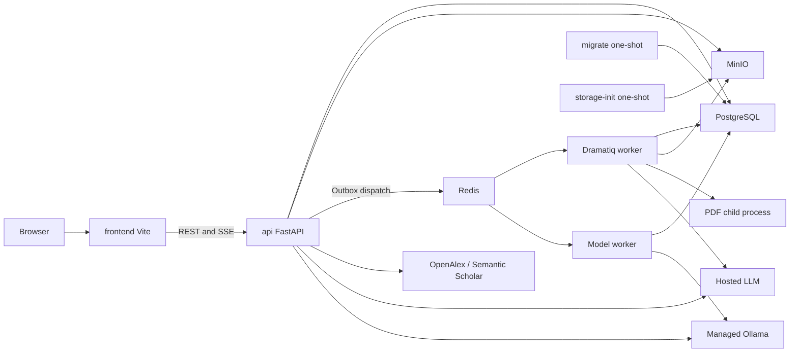

# AI Research Assistant — Approved Implementation Plan

Approved by the user with “Implement the plan.” The conversation proposal is the source for this persisted implementation specification. Preserve the core choices below; log material corrections before implementing them.

Implementation status is recorded in [execution progress](execution-progress.md) and [final verification](verification-final.md). Planning observations below preserve their original time scope. The October 8 [managed-local-model specification](plans/ARA-022-managed-local-models.md) supersedes the earlier deferred local-serving proposal. GitHub pushing is deferred at the user's request. Model capabilities reside in typed Python registry metadata and verified local installation records; the database also stores defaults and race-safe generation reservations. Conservative UTF-8 byte bounds protect provider-specific input budgets when an exact tokenizer is unavailable.

## Requirements, priorities, and assumptions

The authoritative homework is `hw1.md`, due October 10 at 11:59 PM (assume 2026, America/Indiana/Indianapolis). The application accounts for 60% of the grade and the reflection for 40%. The assignment requires search, a persistent library, PDF metadata extraction, content-grounded summaries, paper Q&A, a GUI, backend, database, external API and LLM, a GitHub repository, a short demo of the five workflows, and a genuine coding-agent reflection. The chosen stack, Docker, and TDD/BDD are additional project requirements. The user confirmed 30+ development hours, funded OpenAI access, public GitHub distribution under AGPL-3.0, and a working locally written PDF skill.

- **P0:** Six-service Compose foundation; migrations, bucket initialization and reload; both academic adapters; persistent deduplicated library; original PDF storage, extraction and editable metadata; durable jobs and recovery; hosted model selection and reasoning; page-aware retrieval and citations; persistent streaming multi-turn chat; focused tests; setup docs; repository and submission evidence.
- **P1:** The user-requested local PDF skill early; accessible full-text retrieval, richer retrieval heuristics, extra UX polish and user-approved managed local inference (ARA-022, ARA-044–049).
- **P2:** pgvector, embeddings and hybrid retrieval; OCR; advanced history management.

This is a single-user local app with no authentication, payments or multi-tenancy. API keys stay server-side. The app must start without hosted credentials or local models; analysis reports missing access clearly. Full-text analysis is blocked for metadata-only or unprocessed papers.

### Environment and findings

The repository is greenfield, with empty src/docs/tracker/guide directories. The host is an Apple M3 Pro with 36 GiB of memory. OrbStack runs Linux ARM64 with Docker 29.4 and Compose 5.1; the VM has approximately 15.7 GiB of memory and 12 vCPUs. There is no initial commit or Git remote. Work on a feature branch in place until a baseline exists; preserve user-owned assignment files and writing skills.

Context7 is installed and enabled, but exposed calls return USER_NOT_LOGGED_IN or report that it is not connected. Use official docs; do not claim Context7 retrieval. A live OpenAlex query returned 200 with abstract and PDF metadata; Semantic Scholar returned 429. Python's host urllib failed certificate verification; curl succeeded without bypassing TLS. These are planning observations, not application tests.

MinIO community is archived, unmaintained and source-only. Retain it through a custom ARM64 multi-stage image built from pinned source: commit `7aac2a2c5b7c882e68c1ce017d8256be2feea27f`, with a verified archive, explicit version/linker constants and upstream checksums. Do not use its upstream Dockerfile blindly; it references minio/minio:latest. A real build and S3 checksum test is an early gate, not a verified fact.

The requested official hosted models gpt-5.6-sol/terra/luna are documented with streaming, structured output, and reasoning levels none/low/medium/high/xhigh/max. Their advertised limits are 1.05M context and 128K output. Account access remains a live gate. Default to Luna with low reasoning; application budgets are much smaller than the advertised contexts.

Sources: [SQLAlchemy asyncio](https://docs.sqlalchemy.org/en/20/orm/extensions/asyncio.html), [psycopg dialect](https://docs.sqlalchemy.org/en/20/dialects/postgresql.html#module-sqlalchemy.dialects.postgresql.psycopg), [Dramatiq async actors](https://dramatiq.io/cookbook.html#asyncio-actors), [PyMuPDF processes](https://pymupdf.readthedocs.io/en/latest/recipes-multiprocessing.html), [MinIO upstream](https://github.com/minio/minio), [shadcn/Vite](https://ui.shadcn.com/docs/installation/vite), [OpenAlex auth](https://help.openalex.org/api/authentication/), [S2 API](https://api.semanticscholar.org/api-docs/).

### Traceability

| Requirement | Issues/components | Tests/acceptance | Demo |
| --- | --- | --- | --- |
| Search | 006 adapters/form | Both providers, nullable fields, paging/errors; E2E01 | Search a real topic |
| Library | 007 paper repository/UI | Save, concurrent DOI deduplication, refresh/restart; E2E02 | Save and reopen |
| PDF metadata | 009–010 storage/parser/jobs/editor | Known fields, originals, pages, invalid/scanned/encrypted PDFs; E2E03 | Upload, status, metadata |
| Grounded summary | 013 worker/LLM | Actual text, coverage, provenance; E2E04 | Generate a summary |
| Paper Q&A | 011, 014–015 retrieval/SSE/history | Paper isolation, follow-up, citation, refresh; E2E05 | Ask and inspect the page |
| Integrated stack | 003–016 | Real core services plus a separately logged external smoke test | App walkthrough |
| Repository/README | 017 | Clean setup, lockfiles, no secrets | Repository link |
| Video/reflection | 001, 018 | Five workflows and authentic prompt/correction screenshots | Brightspace submission |

## Architecture

Use a modular monolith: Python 3.13, FastAPI, Pydantic 2/Settings, SQLAlchemy 2 with async psycopg 3, Alembic, httpx, Dramatiq/Redis, and PyMuPDF. The frontend uses React/Vite, strict TypeScript, Tailwind 4/shadcn, TanStack Query, declarative React Router, and RHF/Zod, with no initial Zustand. Use Node 24, uv/npm lockfiles, and digest-pinned container images. Router loaders are unnecessary alongside Query. Backend routes, schemas, models, repositories, services, integrations and jobs have explicit boundaries; business decisions remain in Python.

### Compose/runtime

Run eight persistent services: frontend, api, worker, model-worker, Ollama, postgres 17, redis 8.2, and minio. Reuse the backend image for migrate/storage-init and both worker roles. Health gates use service_healthy; initialization gates use service_completed_successfully. Core readiness does not depend on Ollama. Migrations use Alembic's async bridge/run_sync and a short-lived NullPool. Initialize the MinIO bucket through the backend SDK to avoid the unavailable mc image.

Bind source code; dependencies stay in container paths. Support Vite HMR, Uvicorn reload and debounced worker reload through `app.jobs.development_worker`. Burst SIGHUP from Dramatiq's original watcher stalled a model worker during E2E; the wrapper instead stops its complete worker process tree before replacement. Use named DB/storage/Redis/model volumes. Frontend/API ports are configurable and bound to loopback; infrastructure and Ollama ports remain unpublished. Vite proxies /api; CORS uses explicit allowed origins. Bound resources/concurrency and support graceful shutdown. /health/live and /health/ready do not require external credentials.

Bootstrap an ignored .env with generated internal credentials; never overwrite an existing .env. The user configures hosted credentials there, never in chat. Runtime precedence is environment > dotenv > defaults; explicit constructor settings are reserved for tests. Examples use placeholders. Browser environment variables expose only the public API path. Reset requires an explicit flag, and tests never touch development data.

### Jobs and async lifecycle

Initialize API engines and HTTP clients in lifespan. Give each request, dispatcher, heartbeat and task its own AsyncSession. Create worker resources after fork on the AsyncIO loop, and dispose of them before it stops. Use one process and two threads. Do not share pooled engines across loops, call asyncio.run per actor, share sessions, or rely on implicit lazy relationship I/O.

Commit BackgroundJob and JobOutbox records with domain changes. The API lifespan dispatcher polls every 2 seconds, uses its own sessions, and claims due events with locks. Offload synchronous broker calls and enforce a socket timeout. Publish before marking an event delivered; duplicates are expected. Actors receive jobID+generation and atomically claim a lease. Stale, completed or active duplicate deliveries are no-ops.

Heartbeat every 10 seconds, use a 60-second lease, and run recovery every 30 seconds plus a startup scan. Recover delivered-but-unclaimed jobs and expired processing jobs. Fence final writes by generation+lease. PostgreSQL owns the three total attempts and exponential backoff with jitter; set actor max_retries=0. Redis uses AOF/everysec/noeviction. During API downtime, dispatch and recovery wait while delivered work continues. Exactly-once paid inference cannot be guaranteed across ambiguous failures.

Job states are queued → processing → completed. Retryable failures transition processing → queued; permanent or exhausted failures transition to failed. An explicit eligible retry transitions failed → queued. Persist typed inputs, safe errors, progress/stage and results. The ingest parser has a 120-second timeout; summaries have a 10-minute deadline and checkpoints. Metadata provider errors preserve usable text. Bound optional downloads and embeddings, and make them idempotent.

## Data and API design

Use UUIDs and UTC timestamps. Store PDF bytes only in MinIO. Persist the following records:

- Paper: nullable bibliographic fields, normalizedDOI, provenance, manual overrides and activeDocument.
- PaperAuthor: ordered author rows.
- PaperSource: unique(provider, externalID), URLs and a metadata snapshot.
- Document: original object, hash, name, size, state, extractorVersion and warnings.
- DocumentPage: text, physicalPage and printedLabel.
- DocumentChunk: page offsets, ordinal, text, token estimate and GIN tsvector.
- PaperSummary: document, configuration, sections, citations, usage and promptVersion.
- ChatSession: immutable paper/document binding and defaults.
- ChatMessage: ordered roles, content, requestUUID, state, model, settings, citations, generationLease and expiry.
- BackgroundJob/Outbox: durable execution state.
- ModelConfiguration: registry, capabilities and defaults, with no credentials.
- ModelInstallation/ModelRequest/ModelUse: local installation intent/validation, operation UUID identities and durable global inference leases (migration `0005_local_models`).

Enforce uniqueness for non-null normalized DOI, source identity, document checksum in the single-user library, chunk/page ordinals, active job keys, session requestUUID, and one active assistant generation per session. Matching DOI, source or checksum deduplicates; title similarity only warns. A conflicting attach returns a reconciliation error. Manual corrections override enrichment. Historical chats and summaries retain their source document versions. Review Alembic migrations and test them from an empty DB and the previous milestone.

Use the prefix /api/v1. Generate TypeScript contracts with openapi-typescript and detect drift in CI; explicitly document discriminated SSE events. Errors use {code, message, request_id, details, retry_after?}, with appropriate 404/409/413/415/422/429/502/503/504 statuses. SearchResult has normalized nullable fields; PaperDetail includes provenance and readiness; JobStatus includes stage, progress and retry information; GenerationSettings validates capabilities; Citation includes chunk, document, page and excerpt.

| Route | Behavior |
| --- | --- |
| GET /search | provider/query/pageSize/opaqueContinuation; normalized page |
| POST /papers | provider/externalID; canonical lookup; 201 for new, 200 for existing |
| GET /papers; GET/PATCH /papers/{id} | Paginated library, details and manual correction |
| POST /documents | Multipart file, optional paper and requestUUID; 202 with references |
| GET /documents/{id}/download | Retained PDF through the API |
| GET /documents/{id}/chunks/{chunkID} | Validated source excerpt |
| GET /jobs; GET /jobs/{id}; POST /jobs/{id}/retry | Durable state and eligible retry |
| POST/GET /papers/{id}/summaries | Queued generation and history; ready text required |
| POST/GET /papers/{id}/chats | Create/list chats with an immutable document binding |
| GET /chats/{id}/messages | Ordered history and generation state |
| POST /chats/{id}/messages/stream | question/requestUUID/model/settings; SSE |
| GET /models; GET/PUT /settings | Capabilities, availability and defaults; no secrets |
| POST /models/{key}/download; DELETE /models/{key}/installation | Durable idempotent local installation/removal; preserved default/history |
| POST /jobs/{id}/pause; POST /jobs/{id}/resume | Local transfer controls; paused only after acknowledged settlement |
| POST /papers/{id}/retrieve-fulltext | P1: stored provider PDF candidate; no arbitrary URL |

## Pipelines and security

The search interface is search(query, continuation, pageSize) → SearchPage. S2 uses relevance/offset and explicit fields; OpenAlex uses works/cursor, reconstructs abstract positions, and selects a direct location pdf_url. Preserve nullable fields honestly; a landingURL is not a PDF. Use a page size of 20. Bound provider response bodies and continuations; use explicit async HTTP timeouts, at most two bounded transient retries, and Retry-After. Invalid credentials and malformed responses must not trigger indefinite retries. Show empty results, rate limits and outages clearly.

Upload validates the PDF signature/media type and a 25 MiB limit. Record the upload state and objectUUID, store the object outside the DB transaction, then create the queued job/outbox. The worker performs a bounded temporary download and invokes a fresh isolated parser via subprocess; on timeout, kill and wait for the subprocess. Enforce a 200-page limit and a text limit. Encrypted PDFs that need a password fail; scanned PDFs report OCR_REQUIRED; partial scans warn.

Extract deterministic metadata first. When needed, use structured nullable LLM extraction grounded in evidence; do not use PDF creationYear or fabricate fields. Enrichment failure does not discard extracted text. Page-aware chunks of approximately 800 tokens with 120-token overlap retain offsets and version. Fence chunk persistence and the ready transition, and commit them transactionally.

P1 downloads use only configured public hosts and stored provider candidates. Reject credentials, private addresses, unsafe protocols and redirects; validate every hop and enforce streaming limits. Treat untrusted PDFs and context as data, never executable instructions. Include no credentials or tools in prompts, and render no raw HTML in the UI. Logs use safe JSON with request/job IDs, never API keys, full prompts or document contents. Restrict hostnames/origins, use safe filenames/object keys, and bound LLM tokens and cost.

The hosted adapter uses the official AsyncOpenAI/Responses API with store=False. The local adapter uses Ollama native `/api/chat`, keeping NDJSON thinking separate from answer content and validating structured output. The registry supports the three requested hosted models and three pinned local artifacts; persist effective parameters, capabilities, provider/runtime/artifact provenance and usage. Default to Luna/low with a 32k input ceiling and 4k output budget, including reasoning. Hosted calls use a configurable $5 daily budget and conservative reservations; local calls use no hosted key or dollar reservation and never fall back to a paid provider. Default local allocation is 8,192 context, 2,048 output and 512 safety tokens. Enforce the smaller provider budget throughout history, retrieval, whole-document batching and reduction.

Summaries use the complete extracted text when it fits. Otherwise, use ordered map/reduce with full coverage, retained references and checkpoints. Never silently summarize only the first pages. Q&A uses SQL FTS with GIN/ranking, a strict → OR fallback and bounded section coverage, scoped to the immutable document. Persist all history; limit recent complete turns to 4k history tokens and retrieval to 12k tokens. Use recent questions and deterministic section terms to interpret follow-ups. The effective context reserves instructions, output and a safety margin. Use the tokenizer when known; otherwise, use conservative byte estimates. Report insufficient evidence explicitly. Validate CitationIDs against the supplied passages/document, and obtain page numbers from the DB. Factual support in real answers requires manual checking beyond mock tests.

Use POST fetch SSE with message.started/delta/completed/failed events and heartbeats. Persist before started, checkpoint partial content, and persist the final result before completed. The frame parser handles UTF-8 and fragments. Abort closes the provider stream and persists partial content as interrupted. API crash recovery expires direct generation leases and releases the active constraint. UUID replay never regenerates: active requests conflict, while finished/interrupted requests return stored state. Never automatically resubmit paid generation.

## Interface and local skill

Use Impeccable Operate/Read guidance: quiet light surfaces, dark text, one accent, system fonts and consistent tokens. Routes cover /search for provider/results/save/load more; /library for saved list/upload/status; /papers/:id for bibliography/edit/status/summary/chat; /settings for capabilities; and /jobs for progress/errors/retry. Metadata-only, processing, ready and failed states have actionable gates. Desktop uses a metadata sidebar and reader; mobile uses stacked layouts and sheets. Support keyboard upload, labels, focus, dialogs, polite live announcements, scroll preservation, safe generated/source rendering and citation excerpts.

Install the supplied PyMuPDF instructions under .agents/skills/pymupdf-pdf with required frontmatter, local scripts/pymupdf_parse.py, and references/pymupdf-notes.md. The CLI supports md (default)/json/both, images, tables, outroot and lang. Outputs use a basename folder with output.md/output.json/images/tables.json. Use an inline uv dependency, script lockfile and executable shebang; provide an explicit uv alternative. Test page-preserving outputs, rough tables/images, invalid/encrypted PDFs, safe paths and collisions; ignore outputs. Do not use marketplace registration, unpinned npx or automatic OCR. The application remains independent of the skill. The remote skill has unaudited scripts and therefore is not installed.

## Testing and acceptance

For each feature, follow Given/When/Then → observe a failing behavior test → minimal implementation → targeted green test → refactor/regression → issue/evidence/commit. Use real core dependencies and HTTP external fixtures only, with forced test mode and a separate Compose project, DB and bucket. Mocked tests do not prove hosted or live access.

- E2E01: Select a provider and topic → normalized results, load more and errors.
- E2E02: Save from search → library persists across refresh/restart, with DOI deduplication.
- E2E03: Upload a known PDF → retained original, progress, known metadata and ready text.
- E2E04: Summarize a ready PDF → actual text, full coverage and persisted citation.
- E2E05: Ask a question and follow-up about a ready PDF → streamed grounded answer, page citation and history after refresh.
- Additional cases: metadata-only gate; scanned, encrypted, oversized and malformed PDFs; malicious source; absent context; broker outage; duplicate jobs; parser timeout; expired leases; chat recovery after API termination; UUID replay.

Use pytest for units, adapters, validation, text and context. Integration tests exercise actual PostgreSQL migrations, constraints and repositories; Redis delivery; and MinIO checksums/restart. Use Vitest/RTL for forms, status, capabilities, SSE and errors, and Playwright for the actual stack with delayed HTTP fixtures. Keep real provider/model smoke tests separately opt-in. CI runs Ruff/pytest; ESLint/tsc/Vitest/build; migrations/integration/Chromium E2E, with failure traces. Use synthetic known PDF/DOI fixtures and a licensed research demo PDF.

## Roadmap and tracking

| Phase | Current status | Issues/deliverable | Gate/risk |
| --- | --- | --- | --- |
| 0 Foundation | Complete | 001–005, 008; plan/skill/services/contracts/test canary | MinIO build, S3 round trip, migration, reload and restart |
| 1 Search/library | Complete | 006–007 | Two adapters plus search/save/persistence; live S2 rate limits handled |
| 2 Ingestion | Complete | 009–011 | Retained PDF, metadata, editor and page chunks |
| 3 LLM/chat | Complete | 012–015, expanded by 033–040 | Hosted smoke test, current UI, context/replay/recovery and browser checks |
| 4 Enhancements | Continued iteration backlog | 019, 021–023, 043 | Safe downloads, semantic retrieval, local-serving feasibility, OCR and longer conversation context; focused verification for each |
| Managed local inference | Implementation/review and integration verification in progress | 022, 044–049 | Durable controls, native generation, deterministic browser checks and opt-in 7B evidence; final application checks remain a gate |
| 5 Submission | In progress, alongside feature iterations | 017–018, 042 | Current-UI live demo, authentic reflection, updated evidence, public repository and submission |

The user rejected the agent's recommendation to freeze feature work after reaching the homework baseline. The earlier human-oriented effort ranges and automatic freeze are superseded. Prioritize dependencies and observed agent throughput; investigate actual resource constraints instead of assuming human development speed. Keep the October 10, 11:59 PM submission requirement visible while continuing iterations and preparation in parallel. The lead owns contracts/migrations and integration verification. Delegate independent work to disjoint file owners and review milestones. Scope reductions require a concrete reason and the user's decision.

Issue IDs map as follows:

| ID | Scope |
| --- | --- |
| 001 | Plan/tracker/journal |
| 002 | Skill |
| 003 | Compose |
| 004 | Contracts/test foundation |
| 005 | Live probes |
| 006 | Search |
| 007 | Library |
| 008 | Jobs |
| 009 | Upload |
| 010 | Extraction |
| 011 | Retrieval |
| 012 | LLM |
| 013 | Summary |
| 014 | Chat |
| 015 | Reader UI |
| 016 | QA/security |
| 017 | CI/README/repository |
| 018 | Submission |
| 019 | OA fetch |
| 020 | Polish |
| 021 | pgvector |
| 022 | Local LLM |
| 023 | OCR |
| 024 | Connector bug |
| 044–049 | Managed runtime, durable operations, native generation, UI, QA and documentation |
| 050 | Baseline frontend development-tool dependency advisory triage |

Keep full records in issue_tracker; create bug tickets for actual failures.

### Managed local inference

The approved ARA-022 work adds default CPU Ollama with no automatic weight download or loading, a persistent `ollama-models` volume, separate `local-models`/`local-generation` queues and Settings controls. Curated Q4_K_M references are IFM K2 Horizon 3.7B, IFM K2 Horizon 7B and Qwen3.8 27B. Missing or unverified weights remain visible and unavailable. Download/pause/resume/retry/delete identities and installation state are durable; deletion preserves histories/defaults and unavailable generation has no paid fallback. See the [API contract](api-contract.md) for exact public fields and errors.

Stock Ollama 0.40.1 rejected real IFM 7B with unknown K2 architecture. The reviewed image pins that Ollama source and compatible upstream llama.cpp b11454, adapts Ollama hooks/CLEF integration and adds version-1 operation-scoped acknowledged pause. After restart, an unknown valid operation UUID pause establishes a canceled tombstone before acknowledging; a late same-UUID pull returns 409. This revised ruling supersedes original private 404 behavior. Tombstones last one daemon lifetime, so PostgreSQL recovery re-establishes settlement on the current runtime before releasing ownership. No pause restarts the daemon.

Resource defaults are a configurable 12 GiB ceiling, four CPUs/threads, 8,192 context, 2,048 output, one loaded model/inference lane and two-minute idle unload. The memory ceiling is not startup allocation or a guarantee that every artifact fits. The final retained-7B ARM64 CPU engine run measured about 6.52 GiB steady and 10.30 GiB peak in a 15.66 GiB Docker VM. Its exact weight/manifest hashes, real streaming completion, schema output, default/disabled thinking and independent transfer-pause/inference behavior passed. A separate earlier real transfer resumed retained ranges. Only 7B has live evidence; 3.7B and 27B are not claimed from fixtures. Qwen's roughly 17.74 GB catalog download needs a higher container/host memory budget, with its actual footprint unmeasured here.

NVIDIA/CUDA and AMD/ROCm overrides build the same patched sources for compatible native Linux hosts. They and native amd64 CPU are provided configurations, without hardware validation in this run; macOS Docker uses CPU. Runtime patches, pinned source/image identities, included MIT licenses, opt-in isolated live runner and measurements are documented in [the runtime record](../docker/ollama/README.md). Model artifacts have separate Apache-2.0 licenses and are never embedded in the image. Acknowledged pause requires the managed protocol, so an unmodified external endpoint cannot provide that guarantee.

ARA-044–046 implementer handoffs and scoped re-reviews have resolved the reproduced runtime isolation, model ownership/recovery, summary checkpoint/compression and chat-budget defects. The integrated backend run after the first review fixes passed 169 tests against isolated real services; a later pre-recovery-chain-fix run passed 172; the frontend suite passed 354 with strict TypeScript/ESLint and a passing production build. All four new local-model fixture browser journeys passed. Repeated-restart acknowledgment loss and queued-to-claimed pause admission were subsequently reproduced by independent re-review, and their corrections are in progress. These counts do not mark final integration complete. Lead-owned final backend/recovery rerun, debounced reload verification and full application live summary/Q&A evidence must be recorded before closing the milestone. Continue the other P1/P2 iterations and submission preparation according to user priorities.

### Definition of Done

Acceptance criteria are satisfied; relevant tests actually pass; there is no critical regression; schema/API/types are documented; Compose and reload work; data persists; retry/error states are honest; issues are updated; and genuine agent corrections are recorded without secrets. The student can explain the components.

The reflection journal covers prompts, decisions, visible failures, diagnosis, follow-ups, evidence, issues, commits and screenshots; never hidden reasoning or invented failures. Keep the guide concise and preserve the authenticity of the student report. Verify the public repository, README, video and reflection for submission. The agent cannot claim Brightspace submission without doing it.

### ARA-022 completion on the feature branch

Managed local models are implemented and independently reviewed on `feat/managed-ollama`; `main` is unchanged. The completed slice includes default CPU Ollama orchestration without weights at startup, the three-artifact catalog, durable installation controls/recovery, local native generation, Settings/picker/Activity UI and deterministic browser coverage. Ordinary errors retain settlement fences and summaries retain their generation-time provenance. Native sampling uses explicit temperature 0.0. See [latest verification](verification-final.md) for executed checks, live 7B measurements and untested hardware/model limits. Future enhancements and student submission deliverables remain separately tracked.

ARA-053 addresses the user's later readiness UX correction. Installed models refresh stale schema/runtime/context validation automatically with durable verification-only work, independent of browser navigation. Fresh/missing installations still fetch no weights; existing stale installations may run background probes after startup. Settings and Activity distinguish model preparation from transfer progress, with explicit retry only on failure. The [API contract](api-contract.md) records admission, user-intent preservation and derived operation fields; the issue and journal record the actual validation results.
